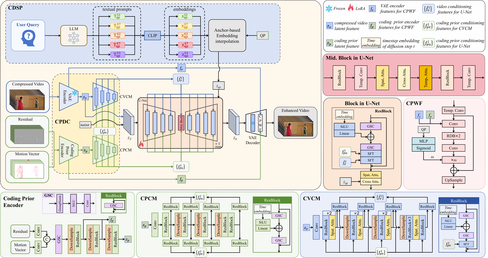

<h1 align="center">DiffCVE: Diffusion-based Compressed Video Enhancement</h1>

<p align="center">
  <a href="https://arxiv.org/abs/2607.07195"></a>
  <a href="https://wqmaker.github.io/projects/DiffCVE/"></a>
</p>

## Overview



## Installation

Run from the repository root.

```bash
conda env create -f environment.yaml
conda activate diffcve
python -m pip install --no-deps peft==0.6.2
```

The inference environment uses Python 3.9, PyTorch 1.12.1, and CUDA 11.3.

Install FFmpeg and specify its executable path with `--ffmpeg`.

## Model files

Download the inference files from [Hugging Face](https://huggingface.co/wqmaker/DiffCVE/tree/main) and place them in `checkpoints/`:

```text
checkpoints/
  multi_step.ckpt
  single_step.ckpt
  video_vae.ckpt
  text_conditions.pt
```

## Data preparation

Use the included [codec](codec/README.md) to encode YUV frames into an H.264 bitstream.

## Inference

### Multi-step

```bash
CUDA_VISIBLE_DEVICES=0 python scripts/infer_multi_step.py \
  --bitstream data/video.264 --qp 37 --fps 50 \
  --ffmpeg /usr/bin/ffmpeg \
  --output-dir results/multi_step \
  --steps 50 --color-correction adain
```

### Single-step

```bash
CUDA_VISIBLE_DEVICES=0 python scripts/infer_single_step.py \
  --bitstream data/video.264 --qp 37 --fps 50 \
  --ffmpeg /usr/bin/ffmpeg \
  --output-dir results/single_step \
  --color-correction adain
```

### Multiple bitstreams

Create a JSON list; bitstream paths are relative to the JSON file:

```json
[
  {"name": "BQSquare", "bitstream": "BQSquare_qp32.264", "qp": 32, "fps": 60},
  {"name": "BQSquare", "bitstream": "BQSquare_qp37.264", "qp": 37, "fps": 60}
]
```

```bash
CUDA_VISIBLE_DEVICES=0 python scripts/infer_single_step.py \
  --bitstream-list data/streams.json \
  --ffmpeg /usr/bin/ffmpeg \
  --output-dir results/single_step \
  --color-correction adain
```

Both entry points support `--bitstream-list`. To partition jobs across GPUs, give each process a distinct `--worker-index` and the same `--num-workers` value.

### Buffers

Use `--rgb-buffer-frames` and `--prior-buffer-frames` to configure CPU buffers. Larger queues use more CPU memory. For example:

```bash
--rgb-buffer-frames 16 --prior-buffer-frames 32
```

### Text input

Both models use `checkpoints/text_conditions.pt` by default. To select another file, add `--text-conditions path/to/text_conditions.pt`.

For raw text input, add:

```bash
--text-encoder-config configs/text_conditioning.yaml \
--text-checkpoint checkpoints/open_clip_pytorch_model.bin \
--prompt "your text"
```

## Citation

```bibtex
@article{xiao2026diffcve,
  title   = {DiffCVE: Diffusion-based Compressed Video Enhancement},
  author  = {Xiao, Wenqiang and Ma, Wenzhuo and Zhang, Junxi and Chen, Zhenzhong},
  journal = {arXiv preprint arXiv:2607.07195},
  year    = {2026},
  url     = {https://arxiv.org/abs/2607.07195}
}
```

## License

The DiffCVE code is distributed under the [S-Lab License 1.0](LICENSE.txt).

## Acknowledgements

Our project is based on [StableSR](https://github.com/IceClear/StableSR) and [MGLD-VSR](https://github.com/IanYeung/MGLD-VSR). We thank the authors for their excellent work.
